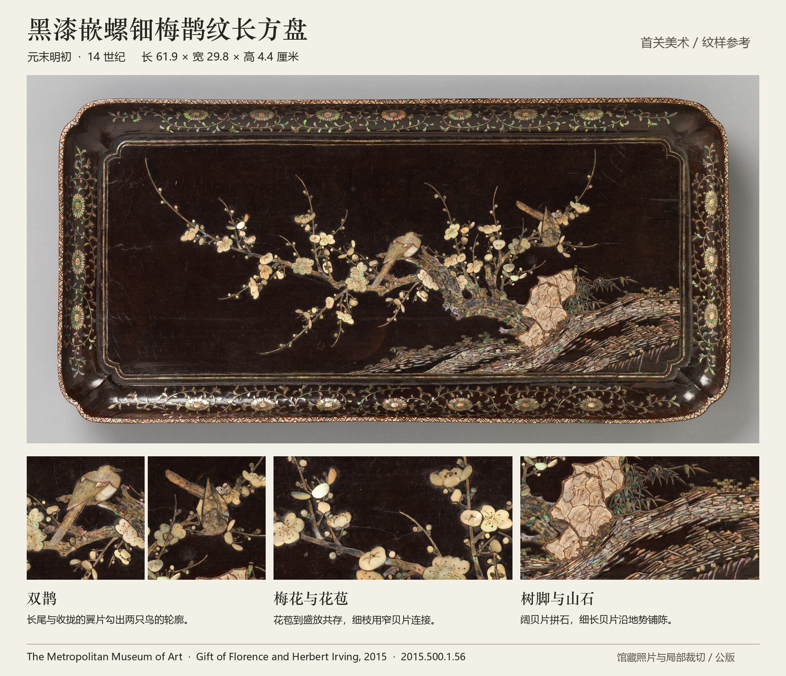
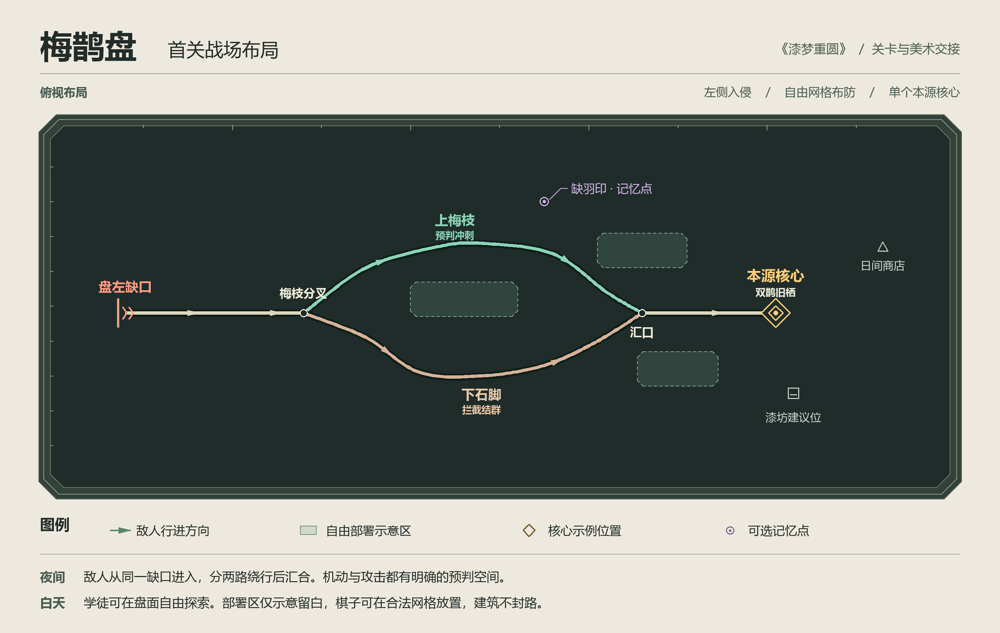

# 第一关 · 梅鹊盘

**敌人、地图与美术交接稿｜供团队评审和白模试做。** 一只喜鹊栖在老梅树上，另一只在盘面上只剩下浅浅的嵌槽。玩家守住六个夜晚，让两只鹊重新落回同一根枝头。

## 器物与委托

首关取形于大都会艺术博物馆藏的**《黑漆嵌螺钿梅鹊纹长方盘》**。这件中国漆器作于十四世纪，长 61.9 厘米、宽 29.8 厘米、高 4.4 厘米。盘心是一株开花老梅和两只鸟。馆方特别指出，地面用细长贝条勾出，树根下的石坡用不规则贝片拼就，几朵梅花中还能辨出蹙眉的脸。选这件器物，是因为只取一棵树上的东西，就够画出整关的敌人、道路和终点。[馆藏图录与公版原图](https://www.metmuseum.org/art/collection/search/40257)

**游戏里的委托是虚构的。** 九十年代，姐姐把一只旧盘和一小片裁好的贝壳带到上海工坊。年轻时姐妹俩合作嵌过这对鹊，妹妹临行前，答应回来补上最后一片尾羽。姐姐一直为她留着那片贝。白天在枝梢能找到尾羽的纸样，错过纸样也能通关。结尾，姐姐把贝片交给学徒，请他补上空了多年的位置。旧裂纹留在两只鸟脚下。游戏用另制的委托盘讲述这件事，年代、地点和人物均属创作。

## 地图表

实物上，树根在右下，梅枝向左伸。战场保留这个朝向，把枝纹和石脚拉开成两条可辨的路线。图中坐标以**盘内可玩区域**为准，左上为 (0,0)，右下为 (100,100)。这些点用于场景构图和白模摆位。玩家在合法网格自由部署；上、下路是敌人行进曲线，建筑不改变寻路。

| 区域与位置 | 白天看见什么 | 夜里怎么走、玩家在哪里做取舍 | 美术落图 |
|---|---|---|---|
| 左盘沿缺口 (8,52) → 枝杈 (28,52) | 外沿裂开，嵌片缺了一角，可以隔着缺口看到盘外 | 全关一个入口。第一夜只走上路；出现双路后，入夜前亮起本夜会走的枝纹 | 缺口是朝内的尖楔。敌人从同一处现身，再在枝杈分流 |
| 上梅枝 (48,32) | 一段向上挑起的老枝；枝头的缺羽印 (55,20) 是可选记忆点，查看后可以看见尾羽纸样 | 螺羽雀从这里快速掠过。部署在上肩 (66,34) 能提前拦雀，但覆盖不到下路石脚 | 枝干压低成可行走的纹路，枝梢有花，主通路留一段平直轮廓给冲刺预警 |
| 下石脚 (48,70) | 树根压在一片宽而扁的贝石上 | 皱眉梅在石脚聚集，螺石随后带着护片向前。下肩 (70,68) 便于提前处理慢敌 | 画出宽短石片间的黑缝。石片贴地，摄像机一侧保持低矮 |
| 枝心空地 (46,48) → 汇口 (66,52) | 上下两条纹在这里重新接到一根枝上 | 中部留白方便转向两线。把输出留在汇口可以兼顾两路，漏过的快敌也会更接近核心 | 中段留连续黑漆平地，合流点画成清楚的 Y 形接缝。图上的三块布防区只是站位举例 |
| 双鹊旧栖／本源核心 (81,52) | 枝头一实一空，两组足印之间露出温白嵌槽 | 所有普通敌人向这里推进。核心被毁即失败；最终夜在此辨认 Boss 的真身 | 核心以相邻的两枚足印和稳定的浅色边缘识别。即使退色，也要能看出目标 |
| 白天商店 (93,33)／漆坊建议位 (83,75) | 右岸北侧设固定购包点，南侧留给玩家摆放天然大漆坊 | 商店只在白天购买。漆坊开局由玩家选址，换到另一处仍能进入第一夜 | 商店是盘边的小托座；漆坊另做可移动摆件。两处轮廓要能一眼分开 |

## 敌人表

本关先画**三种普通敌人和一只 Boss**。螺羽雀沿用团队敌人总表的保留原型，改用喜鹊的长尾剪影。其余三种是本关提案。表内秒数、次数和数量是白模起点，尚待试玩。

| 敌人／取形 | 识别和出招前兆 | 白模行为与玩家应对 | 击退后怎样归纹 |
|---|---|---|---|
| **螺羽雀** · 长尾喜鹊 | 尖喙、两片剪开的长尾；平飞时收翅，冲刺前压身并把尾羽拉成直线 | 快敌，先走上路。进汇口时停顿 0.8 秒，随后沿原路冲刺一次。玩家可在展尾时从侧面推挡，打断这一次冲刺 | 羽片贴平，拼回枝上一小段尾纹 |
| **皱眉梅** · 藏着人脸的花 | 五瓣围成矮圆轮廓。走动时露出皱眉，站定时花瓣合拢、背面朝外 | 慢敌，在下路石脚合瓣一次，持续 2 秒，承受伤害减半；随后张开并继续前进。可趁停步先处理同来的快敌 | 花心舒展，整朵摊平嵌回枝条 |
| **螺石** · 树根下的不规则贝片 | 横宽、贴地，肩上只有一大片明亮护片。每次命中护片都显出一道裂缝 | 慢速护甲敌。前两次有效命中各由护片吸收，第二击后壳脱落，后续可正常造成伤害。学徒的普通攻击就能剥壳 | 石片下沉，与石脚缺角对上；掉落的碎片很快熄光 |
| **候枝鹊** · 等在原处的那只喜鹊 | 明显大于螺羽雀，尾部缺一枚长羽。双脚有接触影，回声只有一圈空心贝线 | Boss 独占最终夜。先走上枝。首次降至半血或首次走完上枝时，沿原枝飞回分叉；哪个先发生就在哪时折返，整晚只折返一次。停栖 2 秒后，真身从下路趋向旧栖，旧影沿上路重走。旧影无法选中、无碰撞；玩家可以凭足影转去下路。真身抵达核心后按常规攻击，直到一方被击败 | 大鹊伏低，黑影退出，贝纹还原成两只正常大小的栖鹊。尾羽的空位留到现实结尾，由学徒补齐 |

## 六夜怎么排

| 夜 | 从左侧缺口出现的顺序 | 玩家先学会什么／美术第一次要给什么提示 |
|---|---|---|
| 一 | 上路螺羽雀 3，只只错开 | 看懂单入口、汇口蓄力和推挡时机。第一只单独走过枝杈后，第二只再入场 |
| 二 | 下路皱眉梅 3，随后上路螺羽雀 2 | 首次开启下枝，白天先给两条进攻预告。花合瓣时能腾手转向雀群 |
| 三 | 下路螺石 1，后续上路螺羽雀 3 | 第一只螺石单独露面，等玩家看见护片破裂或它走过石脚，再发鸟群 |
| 四 | 下路皱眉梅 3 后接螺石 1；同时上路螺羽雀 4 | 先守汇口还是提前拆护片，形成两种布防选择 |
| 五 | 两批混编，每批上路螺羽雀 3、下路皱眉梅 2 与螺石 1 | 两批之间留一次换位时间。看玩家能否预判快敌，把慢敌留给棋子 |
| 六 | 候枝鹊 1，无杂兵 | 最终夜复用已学会的两条路线。转阶段时两枝同时亮起，真身靠足影和填实的轮廓辨认 |

每夜清空全部实体敌人且核心存活才结算。单只普通敌人退场只补一小块纹样；整盘的修复状态在夜末更新。Boss 的旧影不计入剩余敌人数。失败重试时，将夜数、敌潮和盘面还原到首日。祝福发放时机与棋子技能沿用对应系统的团队决定。

## 给美术的第一批图

| 先画什么 | 画面和分层要求 | 交给关卡后怎样检查 |
|---|---|---|
| **一张盘面，昼夜两套明暗** | 固定斜俯视，完整盘沿只在入场镜头交代。底层黑漆偏褐（建议 `#211B1B`），静止贝片用灰青（`#829D95`），侧光边缘才少量出现粉紫。中层拆出枝、石与嵌槽；上层独立放出怪提示、核心和角色。夜里降低底图亮度，保留敌人脚下与盘面的明暗差 | 在 1280 × 720 战斗画面叠加顶部资源栏和底部卡牌，再看入口、上枝冲刺点、汇口和核心是否完整可见 |
| **四个敌人剪影及关键姿势** | 同比例画在一张黑漆底上。雀看尾、梅看五瓣、石看横宽、Boss 看缺羽和足影。普通敌人各画移动、招式前兆、归纹三姿；Boss 加画停栖、真身与空心旧影同框。给策划标出接地点 | 缩到出场大小，转为灰度，仍能分出四种轮廓；不开音效也能辨别雀将要冲刺、梅已经合瓣 |
| **同一机位的三张修复关键帧** | 入盘时画黑漆缺口、树枝断续、一鹊缺形；第三夜后石脚与梅枝接回，右侧仍有空栖位；结尾两鹊同枝，旧裂保留一道细线。用同位置替换纹样，白模可直接叠合 | 夜末切换时布防地块、足影和核心位置完全重合。战斗消散用“竖起的贝片贴回盘面”，避开满屏粒子 |

**第一轮评图只看三个瞬间。** 白天，第一次见图的人能否指出入口、核心和一块可部署空地；夜里，两种敌人同过汇口时，能否看出哪个即将冲刺；最终夜，关闭颜色提示后，能否选中有足影的真身。先拿这些图试读，再定血量、刷新间隔和最终色值。以上为验收目标，尚未进行真人试玩。

团队依据见[主 GDD](../漆梦重圆｜游戏设计总策划案（GDD）.md)和[敌人设计总表](../漆梦重圆｜敌人设计总表.md)。本页提议首关的器物、路线、委托和敌群，供关卡、美术与系统组一起定稿。
